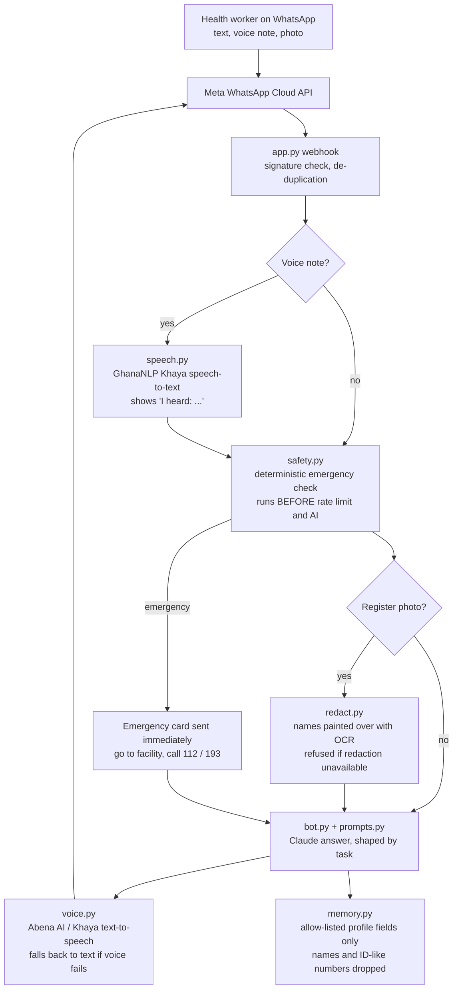

# Akwaaba

**A voice-first AI health assistant for Ghana's community health workers, built on Claude and delivered through WhatsApp, in English, Asante Twi and Ewe.**

[](../../actions/workflows/tests.yml)

Website: [akwaabahealth.org](https://akwaabahealth.org) · Built by Kwabena (KB) Badu-Antwi

Akwaaba ("welcome" in Twi) puts clinical guidance, follow-up reminders and emergency referral into the WhatsApp chats that community health officers, nurses, midwives and volunteers already use. A health worker can send a question as text or as a voice note in their own language and get an answer back as text and, if they want, as a voice note.

This repository is the prototype. It has not been used with real patients. It is shared so reviewers can see how it is built, how it is tested and where its limits are.

---

## The safety design in one picture

The most important decision in Akwaaba is that **the emergency check is plain code, and it runs before the AI on every message.** A health worker describing convulsions, heavy bleeding or a newborn with a fever gets the "go to a facility now, call 112 or 193" card at once, even if Claude is slow, down, or rate-limited.



## What is in here

| Folder | What it is |
| --- | --- |
| [`assistant/`](assistant/) | The WhatsApp assistant and companion web app (Python, FastAPI, Anthropic SDK). Start with [`assistant/README.md`](assistant/README.md). |
| [`assistant/safety.py`](assistant/safety.py) | The emergency fast-path. Deliberately simple and over-inclusive: a false alarm costs a line of text, a miss could cost a life. |
| [`assistant/evals/`](assistant/evals/) | The red-flag test set and the clinician-scored evaluation harness. |
| [`assistant/tests/`](assistant/tests/) | 140 automated tests. No API keys needed. |
| [`assistant/SECURITY.md`](assistant/SECURITY.md) | What was checked, what was fixed, and what is still open. |
| [`language-check/`](language-check/) | 40 health prompts in Twi and Ewe for native-speaking nurses to grade. |

## How it is tested

**1. Red-flag check (the emergency fast-path).** [`evals/red_flags.json`](assistant/evals/red_flags.json) holds urgent cases drawn from WHO IMCI general danger signs, maternal and newborn danger signs, and common community emergencies, plus routine questions that must *not* raise an alarm.

| Group | Caught |
| --- | --- |
| Child | 25 / 25 |
| Newborn | 11 / 11 |
| Maternal | 12 / 12 |
| Adult | 14 / 14 |
| **All urgent** | **62 / 62** |
| Routine questions with no false alarm | 27 / 27 |

The test suite fails if any urgent case is missed, so a change that weakens the safety check cannot pass.

**2. Automated tests.** 140 tests cover the emergency path (including voice notes sent after the rate limit, which must still reach the check), privacy ("FORGET ME" signs the person out and erases everything), upload validation, security headers, name redaction on register photos, and the Twi and Ewe interfaces.

**3. Clinician-scored evaluation.** [`evals/clinician_eval.py`](assistant/evals/clinician_eval.py) sends a 95-case question set (29 urgent, 13 soon, 53 routine) through the same answer path WhatsApp uses, then builds one scoring workbook per clinician. Each clinician scores independently, and the harness reports how many answers could be acted on as written, needed changes, were unsafe, or understated urgency. One model run is recorded in [`evals/results/`](assistant/evals/results/).

**4. Human review.** The prototype went through two rounds of review with five reviewers in Ghana and an outside AI code review. Every critical finding was fixed.

Run everything yourself:

```bash
cd assistant
pip install -r requirements.txt pytest
python -m pytest -q              # 140 passed
python evals/run_red_flags.py    # 62/62 urgent, 27/27 routine
```

Register-photo tests need Tesseract, and voice tests need ffmpeg (`brew install tesseract ffmpeg` or `apt-get install tesseract-ocr ffmpeg`).

## Privacy by design

- **No patient names are stored.** Follow-ups are tracked by card or register number. Any other words in a follow-up entry are dropped before saving.
- **Register photos have names painted over before Claude sees them.** If redaction is not available, the photo is refused, not sent. The feature is off by default until the district and Ghana's Data Protection Commission approve it.
- **Memory is allow-listed in code, not just in the prompt.** Only named profile fields are kept, values are length-capped, and anything that looks like a phone or ID number is dropped.
- **People control their data.** "MY DATA" shows exactly what is remembered. "FORGET ME" erases it and signs the companion app out.
- **The usage log stores one-way codes, not phone numbers.**

## Honest limits

These are written down on purpose. The full list is in [`assistant/SECURITY.md`](assistant/SECURITY.md) and [`assistant/README.md`](assistant/README.md).

- The emergency card fires on English phrases. Draft Twi and Ewe danger phrases run in **shadow mode**: matches are counted, never acted on, until native-speaking clinicians review them.
- The Ewe interface was drafted with AI help and still needs native-speaker review.
- Speech recognition accuracy in Twi and Ewe has not been measured yet. That is what `language-check/` is for.
- SQLite on one machine, no encryption at rest, no independent penetration test yet. All are planned before any real patient data.
- Immunisation schedules, stock levels and the monthly-return layout are placeholders until the district confirms them.

## Built with

Claude (Anthropic) for reasoning · Meta WhatsApp Cloud API and WhatsApp Flows · GhanaNLP Khaya for Twi, Ewe and Ghanaian English speech · Abena AI for Ghanaian voices · FastAPI · SQLite · Tesseract OCR · ReportLab · OpenStreetMap

## What comes next

A 90-day plan covers district approval, Data Protection Commission registration, ethics review and a university partnership, followed by a supervised pilot with community health workers.

---

*Shared for review. Not a medical device and not for use with real patients.*
